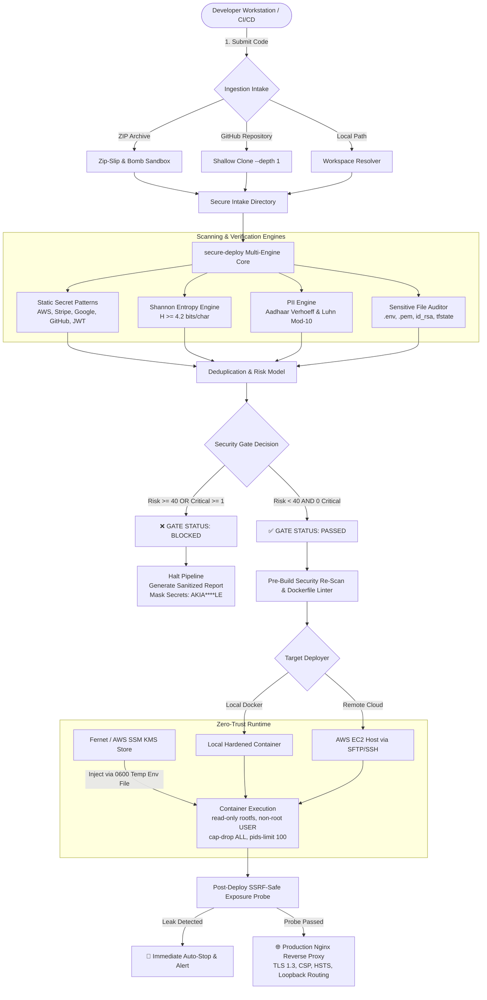
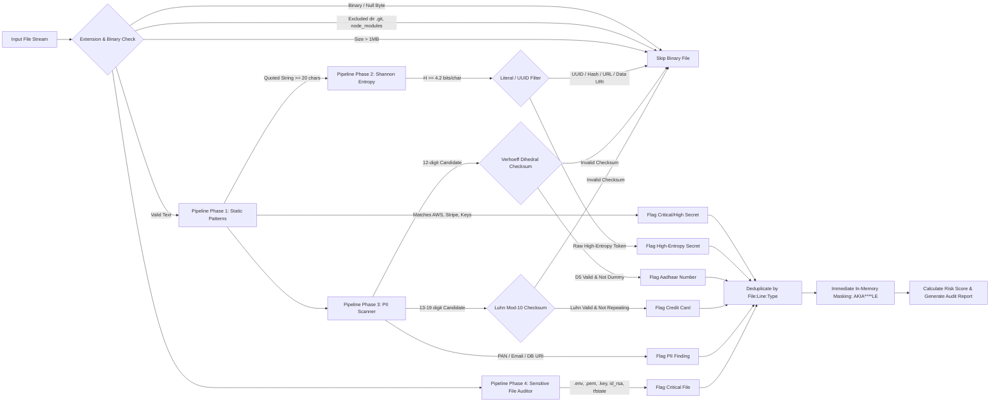
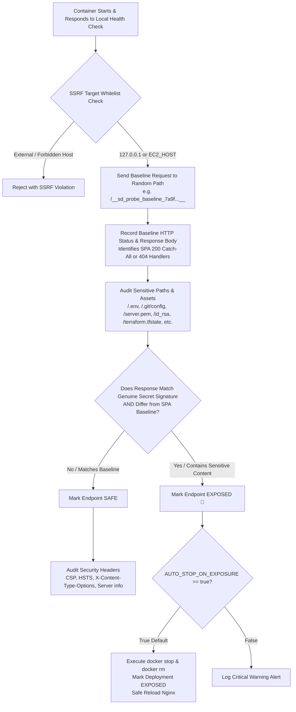
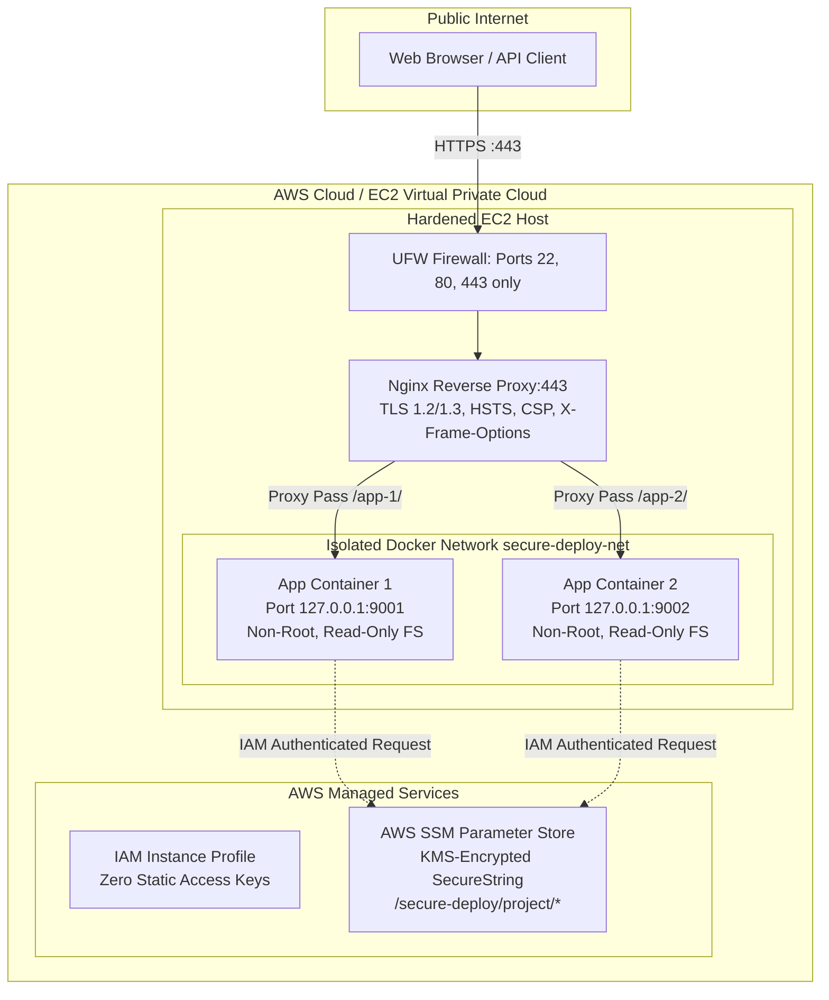

# secure-deploy 🛡️

[](https://pytest.org)
[](https://python.org)
[](https://fastapi.tiangolo.com)
[](https://nextjs.org)
[](https://www.typescriptlang.org)
[](https://tailwindcss.com)
[](https://docker.com)
[](https://aws.amazon.com)
[](LICENSE)

> **Enterprise-Grade Pre-Deployment DevSecOps Quality Gate, Secret & PII Scanner, and Automated Zero-Trust Container Deployment Platform.**

---

## 📑 Table of Contents

- [Executive Overview](#-executive-overview)
- [Visible System Workflows & Architecture](#-visible-system-workflows--architecture)
  - [1. End-to-End DevSecOps Deployment Pipeline](#1-end-to-end-devsecops-deployment-pipeline)
  - [2. Multi-Stage Scanner & Verification Workflow](#2-multi-stage-scanner--verification-workflow)
  - [3. Zero-Trust Runtime Secrets Lifecycle](#3-zero-trust-runtime-secrets-lifecycle)
  - [4. Post-Deployment Exposure Probe & Remediation](#4-post-deployment-exposure-probe--remediation)
  - [5. Production Multi-Tier AWS Infrastructure](#5-production-multi-tier-aws-infrastructure)
- [Deep Dive: Core Concepts & Algorithms](#-deep-dive-core-concepts--algorithms)
  - [1. Pre-Deployment Gating vs Post-Commit Scanning](#1-pre-deployment-gating-vs-post-commit-scanning)
  - [2. Shannon Information Entropy for High-Entropy Token Detection](#2-shannon-information-entropy-for-high-entropy-token-detection)
  - [3. Algorithmic False Positive Suppression (Verhoeff & Luhn Checksums)](#3-algorithmic-false-positive-suppression-verhoeff--luhn-checksums)
  - [4. Mathematical Risk Scoring Engine & Gate Thresholds](#4-mathematical-risk-scoring-engine--gate-thresholds)
  - [5. Hardened Intake Sandbox (Zip-Slip & Zip-Bomb Defenses)](#5-hardened-intake-sandbox-zip-slip--zip-bomb-defenses)
  - [6. Zero-Trust Hardened Container Deployment](#6-zero-trust-hardened-container-deployment)
  - [7. Zero-Trust Runtime Secrets Injection & Log Redaction](#7-zero-trust-runtime-secrets-injection--log-redaction)
  - [8. SSRF-Safe Post-Deployment Exposure Probe](#8-ssrf-safe-post-deployment-exposure-probe)
- [Repository & Project Structure](#-repository--project-structure)
- [Frontend Dashboard Walkthrough](#-frontend-dashboard-walkthrough)
- [API Reference](#-api-reference)
- [Local Quickstart & Setup](#-local-quickstart--setup)
- [AWS EC2 & SSM Parameter Store Setup](#-aws-ec2--ssm-parameter-store-setup)
- [Automated Test Suite (52/52 Passing)](#-automated-test-suite-5252-passing)
- [License](#-license)

---

## 🌟 Executive Overview

Accidental exposure of API tokens (AWS access keys, Stripe live keys, Google API keys, GitHub tokens), sensitive Personally Identifiable Information (Aadhaar numbers, Credit Card numbers, PAN cards, email addresses), and dangerous infrastructure artifacts (`.env` files, SSH private keys, `.pem` certificates, Terraform state files) accounts for **over 80% of preventable cloud and database security breaches**.

Once a credential is committed or shipped in a container layer, it propagates into git trees, backup snapshots, and container registries, requiring emergency credential revocation, audit disclosures, and costly incident response.

### The `secure-deploy` Solution

`secure-deploy` operates as an automated, non-bypassable pre-deployment security and quality gate:
1. **Intake**: Ingests codebases via drag-and-drop ZIP archives, public GitHub repositories, or local workspace paths.
2. **Deep Inspection**: Executes static regex extraction, **Shannon information entropy analysis** ($\ge 4.2$ bits/character), and mathematical checksum validation (**Verhoeff dihedral checksum** for Aadhaar and **Luhn mod-10** for credit cards).
3. **Automated Risk Scoring (0–100)**: Calculates an objective risk score. If any **Critical** finding exists or the cumulative score reaches **$\ge 40$**, the gate transitions to **`BLOCKED`**, halting deployment intake before code is built.
4. **Hardened Container Deployment**: If approved (`PASSED`), code is containerized under extreme kernel isolation (`--read-only`, `--cap-drop ALL`, `--security-opt no-new-privileges`, `--memory 256m`, unprivileged user).
5. **Runtime Secret Injection**: Credentials stored in symmetric **Fernet-encrypted** local stores or **AWS SSM Parameter Store (KMS)** are injected via ephemeral `0600` temporary files, completely hidden from `ps` process trees and Docker history.
6. **Post-Deploy Exposure Probe**: Immediately audits the live container for configuration leaks (`/.env`, `/.git/config`) using SSRF-safe baseline differential analysis, auto-stopping the container if an exposure is verified.

---

## 🔄 Visible System Workflows & Architecture

### 1. End-to-End DevSecOps Deployment Pipeline



---

### 2. Multi-Stage Scanner & Verification Workflow



---

### 3. Zero-Trust Runtime Secrets Lifecycle

```mermaid
sequenceDiagram
    autonumber
    actor Admin as DevSecOps Admin
    participant API as Write-Only API (/api/projects/{p}/secrets)
    participant Store as Encrypted Store (Fernet / AWS SSM)
    participant Deployer as Container Deployer
    participant Host as Docker Engine (Local / EC2)
    participant Probe as Post-Deploy Exposure Probe

    Admin->>API: PUT /secrets (SECRET_NAME, plaintext_value)
    Note over API: Validates name format & rejects reserved envs
    API->>Store: Encrypt & Persist (KMS / Fernet Ciphertext)
    Store-->>API: Success (Zero plaintext retained in DB)
    API-->>Admin: 200 OK (Preview: ••••••••)

    Admin->>Deployer: Trigger Deployment (Approved Scan ID)
    Deployer->>Store: Retrieve Decrypted Secrets in Memory
    Deployer->>Host: Create Ephemeral File (.env.<uuid>) mode 0600
    Deployer->>Host: docker run --env-file .env.<uuid> --read-only --cap-drop ALL ...
    Note over Host: Container boots; environment populated in memory
    Deployer->>Host: Immediately unlink/delete .env.<uuid> in finally block
    Note over Host: Zero secrets left on host filesystem or ps aux

    Deployer->>Host: Stream Build & Startup Logs
    Note over Deployer: Redact all injected secret values to **** in memory
    Deployer->>Probe: Trigger Post-Deploy SSRF-Safe Audit
    Probe-->>Deployer: Audit Clean (No /.env or /.git exposed)
    Deployer-->>Admin: Container Running Safely at Loopback Port
```

---

### 4. Post-Deployment Exposure Probe & Remediation



---

### 5. Production Multi-Tier AWS Infrastructure



---

## 🧠 Deep Dive: Core Concepts & Algorithms

### 1. Pre-Deployment Gating vs Post-Commit Scanning

Traditional application security tooling scans code after commits land in git repositories or alerts security teams during periodic weekly scans. By that point:
- Secrets are permanently baked into git commits and branch DAG histories.
- Secrets are baked into intermediate container layers cached in developer machines and registries.
- Attackers running automated public feed scrapers compromise exposed cloud credentials within **sub-minute timeframes**.

`secure-deploy` operates **strictly before deployment intake**. By intercepting code at the deployment boundary (ZIP upload, pull request, or GitHub URL), it halts deployment pipelines with a non-bypassable `409 Conflict` if vulnerabilities are detected, preventing vulnerable code from ever reaching Docker build environments.

---

### 2. Shannon Information Entropy for High-Entropy Token Detection

Static regular expressions excel at detecting formatted keys with known prefixes (`AKIA...`, `ghp_...`, `sk_live_...`). However, modern encryption keys, JWT signing tokens, salts, and custom API tokens often lack recognizable string prefixes.

To detect unpatterned random secrets, `secure-deploy` calculates the **Shannon information entropy** over all quoted strings of length $\ge 20$ characters:

$$H(X) = -\sum_{i=1}^{n} P(x_i) \log_2 P(x_i)$$

Where:
- $X$ is the evaluated string.
- $n$ is the alphabet size of distinct symbols appearing in $X$.
- $P(x_i)$ is the empirical probability (frequency count / total length) of symbol $x_i$.

#### Practical Significance

| String Type | Example | Calculated Entropy ($H$) | Decision |
| :--- | :--- | :--- | :--- |
| **Natural English / Identifiers** | `userProfileConfigurationSetting` | $3.12$ bits/char | **PASS** (Below 4.2 threshold) |
| **Repeated Sequences** | `aaaaaaaaaaaaaaaaaaaa111111` | $1.45$ bits/char | **PASS** (Below 4.2 threshold) |
| **UUIDs** (Standard format) | `c9a646d3-9c61-4cb9-bc1a-5ff7b1234567` | $3.68$ bits/char | **PASS** (Filtered by UUID heuristic) |
| **Git Commit Hash** | `4b825dc642cb6eb9a060e54bf8d69288fbee4904` | $3.81$ bits/char | **PASS** (Filtered by Hex SHA heuristic) |
| **Base64 / Random API Key** | `7qL9#vB2!xM5$kP9&wR1@zT4*yN6^uQ8` | **$4.82$ bits/char** | 🚨 **FLAGGED** as High-Entropy Token |

#### Algorithmic Noise Suppression Heuristics

To prevent false positives, high-entropy evaluation automatically bypasses:
- Quoted strings containing whitespace or tab characters (prose, sentences).
- URLs (`http://`, `https://`, `postgres://`).
- Filesystem paths (`/`, `./`, `../`).
- Base64 image headers (`iVBORw0KGgo...`, `data:image/...`).
- Standard RFC 4122 UUID representations (`^[0-9a-fA-F]{8}-...`).
- 40-character and 64-character lowercase hex hashes (Git SHAs, SHA256 digests).

---

### 3. Algorithmic False Positive Suppression (Verhoeff & Luhn Checksums)

Naive regular expressions matching `\d{12}` or `\d{16}` produce intolerable false-positive rates, flagging arbitrary integers, timestamps, product SKUs, and test identifiers. `secure-deploy` implements mathematical checksum validation:

#### A. Verhoeff Dihedral Checksum (Aadhaar 12-Digit Numbers)
Indian Aadhaar numbers are 12 digits starting with `2–9`. To differentiate legitimate Aadhaar numbers from random 12-digit integers, `secure-deploy` implements the **Verhoeff algorithm**, which operates over the non-abelian dihedral group $D_5$ (symmetries of a regular pentagon):

$$c = \sum_{i=0}^{n-1} d\Big(c, p(i \bmod 8, d_i)\Big)$$

Where:
- $d(j, k)$ is the multiplication table of the dihedral group $D_5$ of order 10.
- $p(i, j)$ is the permutation matrix preventing transposition errors ($ab \leftrightarrow ba$).
- $inv(j)$ is the inverse element table.

Any 12-digit number whose Verhoeff check digit equation does not equal zero is mathematically invalid and discarded immediately without generating a finding.

#### B. Luhn Mod-10 Checksum (Credit Card Numbers)
Credit cards (13–19 digits) are validated using the **Luhn mod-10 algorithm**:
1. Starting from the rightmost digit, double every second digit.
2. If doubling yields a number $> 9$, subtract 9 (sum the digits).
3. Sum all resulting digits. If $\sum \pmod{10} \ne 0$, the candidate is discarded.
4. Consecutive repeating digits (`0000000000000000`, `1111111111111111`) are discarded by checking `len(set(digits)) == 1`.

#### C. Comprehensive Allow-Listing
- **Safe Domains**: `example.com`, `example.org`, `example.net`, `test.com`, `localhost`.
- **Dummy Sequences**: `1234567890`, `0123456789`, `9876500000`.
- **Placeholder Credentials**: `password`, `secret`, `changeme`, `dummy`, `null`.
- **Safe Template Files**: `.env.example`, `.env.sample`, `.env.template`.

---

### 4. Mathematical Risk Scoring Engine & Gate Thresholds

Rather than presenting a raw count of issues, `secure-deploy` computes a normalized **Risk Score (0–100)**:

#### Severity Weights
- **Critical**: `40 points` (AWS keys, Stripe keys, private keys, `.env` files, `.pem` certificates, Terraform state)
- **High**: `15 points` (Google API keys, GitHub tokens, JWTs, PAN cards, DB connection passwords)
- **Medium**: `5 points` (Aadhaar numbers, credit card numbers, `.db` / `.sqlite` files, Dockerfile root user)
- **Low**: `1 point` (Exposed email addresses, unpinned Docker base images)

#### Diminishing Returns Model
To prevent a single noisy file with 50 email addresses from artificially inflating the risk score to 100 while masking critical vulnerabilities, findings are grouped by type. Findings of the same type beyond the threshold of **5** contribute at a dampened factor of **$0.25\times$**:

$$\text{Contribution}(type) = \begin{cases} count \times W, & count \le 5 \\ (5 \times W) + (count - 5) \times W \times 0.25, & count > 5 \end{cases}$$

#### Asymptotic Saturation Ceiling
If raw score $\le 70$, $\text{Score} = \text{round}(\text{raw})$. When raw score exceeds 70, it tapers asymptotically toward 100 using an exponential decay curve:

$$\text{Score} = \min\left(100, \text{round}\left(70 + 30 \times \left(1 - 0.95^{\frac{\text{raw} - 70}{5}}\right)\right)\right)$$

#### Gate Decision Rule

$$\text{Status} = \begin{cases} \mathbf{BLOCKED}, & \text{if Score} \ge 40 \;\lor\; \text{Count}(\text{Critical}) \ge 1 \\ \mathbf{PASSED}, & \text{otherwise} \end{cases}$$

---

### 5. Hardened Intake Sandbox (Zip-Slip & Zip-Bomb Defenses)

When accepting untrusted ZIP archives or GitHub repositories, `secure-deploy` applies rigorous defenses against archive attacks:
- **Zip-Slip Path Traversal**: Every archive entry's resolved path is verified using `Path(target).resolve().is_relative_to(extract_dir)`. Entries with `../` or leading slashes raise an immediate security exception.
- **Zip-Bomb Decompression Limits**:
  - Max compressed archive size: **25 MB**.
  - Max extracted file count: **5,000 files**.
  - Max total uncompressed bytes: **100 MB**.
  - Compression ratio cap: rejections if uncompressed ratio exceeds safe limits.
- **Symlink Escalation Protection**: Directory walking uses `os.walk(..., followlinks=False)` to prevent symlinks from pointing to sensitive host directories (`/etc/passwd`, `/var/run/docker.sock`).
- **GitHub Ingestion Sanitization**: Repository URLs are validated against strict HTTPS regex `^https://github\.com/[\w.-]+/[\w.-]+(?:\.git)?$`. Clones execute with `--depth 1` shallow depth, 30-second timeouts, and isolated temporary workspaces.

---

### 6. Zero-Trust Hardened Container Deployment

When an approved deployment (`status == "passed"`) is triggered:
1. **Pre-Build Re-Scan**: Re-scans the approved source files immediately prior to build to verify no files were tampered with post-approval.
2. **Dockerfile Linter**: Validates:
   - Flagging missing `USER` instruction or running as root (`medium`).
   - Flagging hardcoded secrets in `ENV` or `ARG` directives (`high` — **blocks deployment**).
   - Flagging `EXPOSE 22` SSH daemons (`high` — **blocks deployment**).
   - Flagging remote `ADD` from arbitrary URLs (`medium`).
3. **Auto-Stack Detection & Safe Generation**: If no Dockerfile exists, automatically provisions a multi-stage non-root container:
   - **Static Sites** (`index.html`): `nginx:alpine` running as `USER nginx`.
   - **Node.js** (`package.json`): `node:20-alpine` with multi-stage build running as `USER appuser`.
   - **Python** (`requirements.txt`): `python:3.11-slim` running as `USER appuser`.
4. **Kernel Security Hardening Flags**: Every container executes with:
   ```bash
   docker run -d \
     --name <sanitized-name> \
     --network secure-deploy-net \
     -p 127.0.0.1:<port>:80 \
     --read-only \
     --tmpfs /tmp \
     --memory 256m \
     --cpus 0.5 \
     --pids-limit 100 \
     --cap-drop ALL \
     --security-opt no-new-privileges \
     --restart unless-stopped \
     <image-tag>
   ```

---

### 7. Zero-Trust Runtime Secrets Injection & Log Redaction

Credentials must **never** be baked into Docker image layers, passed via plaintext command-line flags (`-e KEY=val`), or exposed in log outputs:
- **Dual Encrypted Storage Backends**:
  - `local`: Symmetric Fernet encryption (**AES-128-CBC + HMAC-SHA256**) with `0600` master keys.
  - `ssm`: **AWS Systems Manager Parameter Store** using `SecureString` and AWS KMS (`alias/aws/ssm`).
- **Zero-Static-Credentials**: Cloud operations authenticate strictly via the AWS Default Credential Provider Chain (EC2 IAM Instance Profile).
- **Ephemeral Env-File Mounting**: Secrets are injected using `docker run --env-file <temp-file>`. The temporary file is created with restrictive `0600` permissions and unlinked in a Python `finally` block immediately after container start.
- **In-Memory Log Redaction**: Before build or runtime logs are committed to SQLite or returned to the browser, all injected secret values (and their base64 encodings) are automatically replaced with `****`.
- **Write-Only API**: `PUT /api/projects/{p}/secrets/{name}` stores secrets; `GET` endpoints return fixed masked strings (`••••••••`). Plaintext secrets can never be read back via the API.

---

### 8. SSRF-Safe Post-Deployment Exposure Probe

Immediately following container startup, the automated **Post-Deploy Exposure Probe** (`deployer/probe.py`) audits the live container:
- **SSRF Immunity**: The probe strictly audits `127.0.0.1` loopback URLs or the pre-configured `EC2_HOST`. Arbitrary user URLs are rejected.
- **Differential SPA Baseline Detection**: Modern Single Page Applications (Next.js, React, Vue) return HTTP 200 with an HTML fallback for *all* routes. Naive scanners flag false positives on `/.env` because the server returns 200 OK. `secure-deploy` sends a randomized baseline request (`/__sd_probe_baseline_<uuid>__`). An endpoint is only flagged as `EXPOSED` if:
  1. Its response body differs from the SPA baseline.
  2. Its response body matches genuine sensitive signatures (`KEY=VALUE` pairs, `[core]` for git config, `BEGIN RSA` for keys).
- **Automated Kill Switch**: If `AUTO_STOP_ON_EXPOSURE=true` (default), any detected exposure automatically marks the deployment as `exposed`, shuts down the Docker container immediately, and safely reloads Nginx.

---

## 📂 Repository & Project Structure

```text
secure-deploy/
├── backend/
│   ├── main.py                     # FastAPI application entrypoint & platform /api/stats
│   ├── db.py                       # SQLAlchemy models (Scan, Finding, Deployment, Secret)
│   ├── secrets_store.py            # LocalEncryptedStore (Fernet) & SSMStore (AWS KMS)
│   ├── requirements.txt            # Python dependencies (FastAPI, SQLAlchemy, Cryptography, Boto3)
│   ├── api/
│   │   ├── __init__.py
│   │   ├── scans.py                # POST upload, POST github, GET scans, report download
│   │   ├── deployments.py         # POST deploy, stop, live build/runtime logs, probe
│   │   └── secrets.py              # PUT write-only secrets, list metadata, delete secrets
│   ├── scanner/
│   │   ├── __init__.py
│   │   ├── engine.py               # Master scan orchestrator & deduplication engine
│   │   ├── secrets.py              # Regex patterns & Shannon entropy detection
│   │   ├── pii.py                  # Aadhaar (Verhoeff), Credit Cards (Luhn), PAN, Email, DB URIs
│   │   ├── files.py                # Sensitive filenames (.env, .pem, .key, id_rsa, tfstate)
│   │   ├── risk.py                 # Mathematical risk scoring engine & gate thresholds
│   │   ├── utils.py                # Verhoeff tables, Luhn algorithm, binary & skip checks
│   │   └── models.py               # Finding dataclass & mask_secret helper
│   └── deployer/
│       ├── __init__.py
│       ├── base.py                 # Abstract BaseDeployer class
│       ├── local.py                # Local Docker CLI deployer
│       ├── ec2.py                  # Remote AWS EC2 deployer (SSH/Paramiko & SFTP)
│       ├── docker_build.py         # Dockerfile security linter & auto-stack generator
│       └── probe.py                # SSRF-safe post-deploy exposure probe & SPA baseline
├── frontend/                       # Next.js 14 App Router + TypeScript + Tailwind CSS
│   ├── app/
│   │   ├── layout.tsx              # Root dashboard layout & typography
│   │   ├── globals.css             # Dark/Light mode theme tokens
│   │   ├── page.tsx                # Main DevSecOps Dashboard (metrics, gauges, recent scans)
│   │   ├── scan/page.tsx           # New Scan page (ZIP drag-and-drop & GitHub ingestion)
│   │   ├── scans/page.tsx          # Scan History table with search & filtering
│   │   ├── scans/[id]/page.tsx     # Scan Report view (finding cards, risk score, JSON export)
│   │   └── deployments/page.tsx    # Live Container Deployments monitor & exposure probe view
│   ├── components/
│   │   ├── Navbar.tsx              # Navigation bar with active route indicators
│   │   ├── CircularGauge.tsx       # Animated SVG risk gauge (0-100) with color interpolation
│   │   ├── StatusBadge.tsx         # PASSED / BLOCKED / EXPOSED status indicators
│   │   └── SeverityChip.tsx        # Critical / High / Medium / Low severity badges
│   ├── lib/api.ts                  # Typed API client for FastAPI backend
│   └── package.json
├── nginx/
│   ├── default.conf                # Reverse proxy configuration with SSL & dynamic routing
│   └── snippets/security.conf      # Hardened security headers (HSTS, CSP, X-Frame-Options)
├── infra/
│   ├── ec2-setup.sh                # Automated idempotence host provisioning script
│   └── iam-policy.json             # Least-privilege AWS SSM Parameter Store IAM policy
├── tests/
│   ├── test_secrets.py             # Day 1: Secrets & pattern detection unit tests
│   ├── test_day2.py                # Day 2: PII checksums & sensitive file tests
│   ├── test_day3.py                # Day 3: Intake sandbox, zip security, and stats tests
│   ├── test_day4.py                # Day 4: Dockerfile linter, auto-stack, container deploy tests
│   ├── test_day5.py                # Day 5: Secrets store, runtime injection, exposure probe tests
│   ├── test_snippet.py             # Live snippet and edge-case scanner tests
│   └── sample-repos/               # Realistic test applications with intentional traps
│       ├── leaky-app/              # Exposed AWS, Stripe, and .env test fixtures
│       ├── pii-app/                # Valid Aadhaar, PAN, Credit Card, and DB URI fixtures
│       ├── clean-app/              # False-positive traps (UUIDs, git SHAs, test domains)
│       └── key-files-app/          # Exposed .pem, id_rsa, tfstate, and .env.example
├── .env.example                    # Environment variable template
├── .gitignore                      # Hardened git ignore rules
└── pytest.ini                      # Pytest configuration
```

---

## 🖥️ Frontend Dashboard Walkthrough

The `secure-deploy` frontend is built with **Next.js 14**, **React**, **TypeScript**, and **Tailwind CSS**:

1. **Platform Overview Dashboard (`/`)**:
   - **Metrics Bar**: Real-time counter of total scans, gate passed count, gate blocked count, and average platform risk score.
   - **Animated Circular Risk Gauge**: Visualizes average system risk on a calibrated 0–100 scale with dynamic color shifts (Green $\rightarrow$ Yellow $\rightarrow$ Red).
   - **Recent Scans Feed**: Interactive list of recent scans showing status, branch, findings count, and direct link to reports.

2. **New Scan Ingestion (`/scan`)**:
   - **Drag-and-Drop ZIP Upload**: Supports dragging archive packages with client-side size validation.
   - **GitHub Ingestion Form**: Accepts public GitHub repository URLs and optional branch names for automated cloning and scanning.

3. **Scan Report & Gate Audit (`/scans/[id]`)**:
   - **Gate Decision Banner**: Prominently displays `PASSED` or `BLOCKED` with the specific rationale (e.g. *Blocked: 2 Critical findings detected*).
   - **Severity Distribution**: Visual chip breakdown (Critical, High, Medium, Low).
   - **Findings Table**: Detailed cards showing the file path, line number, rule name, and masked preview (`AKIA****LE`).
   - **Export Report**: One-click download of the complete sanitized JSON audit report.

4. **Live Deployments Monitor (`/deployments`)**:
   - **Active Containers**: Displays container names, allocated loopback ports (9000–9999), and deployment target (Local vs EC2).
   - **Live Log Terminal**: Displays sanitized container build and runtime logs with real-time log polling.
   - **Exposure Probe Card**: Displays post-deployment audit results, probed endpoint statuses, and header audits.
   - **Emergency Stop**: One-click control to terminate running containers and safely reload Nginx.

---

## 🔌 API Reference

### Ingestion & Scanning Endpoints

| Method | Endpoint | Description | Request Body / Params | Response |
| :--- | :--- | :--- | :--- | :--- |
| `POST` | `/api/scans` | Scan a local directory path | `{"path": "/absolute/path"}` | Scan result with findings and gate status |
| `POST` | `/api/scans/upload` | Upload & scan a ZIP archive | `multipart/form-data` (file) | Sanitized scan result |
| `POST` | `/api/scans/github` | Clone & scan a public GitHub repository | `{"repo_url": "https://...", "branch": "main"}` | Scan result |
| `GET` | `/api/scans` | List scan history (newest first) | None | Array of scan summaries |
| `GET` | `/api/scans/{id}` | Retrieve scan details and findings | `id` (integer) | Detailed scan record with findings |
| `GET` | `/api/scans/{id}/report` | Download sanitized JSON report | `id` (integer) | Downloadable JSON attachment |
| `GET` | `/api/stats` | Platform metrics & severity stats | None | Summary statistics object |

### Hardened Deployment Endpoints

| Method | Endpoint | Description | Request Body / Params | Response |
| :--- | :--- | :--- | :--- | :--- |
| `POST` | `/api/scans/{id}/deploy` | Trigger container deployment | `id` (integer), `{"project_name": "app"}` | Deployment record with assigned port |
| `GET` | `/api/deployments` | List all container deployments | None | Array of deployment records |
| `GET` | `/api/deployments/{id}` | Retrieve deployment details & logs | `id` (integer) | Deployment record with redacted logs |
| `POST` | `/api/deployments/{id}/stop` | Terminate container & reload proxy | `id` (integer) | Updated deployment record (`stopped`) |
| `GET` | `/api/deployments/{id}/probe` | Get post-deploy audit results | `id` (integer) | Full probe breakdown and verdict |
| `POST` | `/api/deployments/{id}/probe` | Trigger an on-demand re-audit | `id` (integer) | Fresh probe result |

### Secrets Management Endpoints

| Method | Endpoint | Description | Request Body / Params | Response |
| :--- | :--- | :--- | :--- | :--- |
| `PUT` | `/api/projects/{p}/secrets/{name}` | Store secret (write-only) | `{"value": "secret_val"}` | Secret metadata (`value` never returned) |
| `GET` | `/api/projects/{p}/secrets` | List project secret metadata | `p` (project slug) | Array of secrets with preview `••••••••` |
| `DELETE` | `/api/projects/{p}/secrets/{name}` | Delete a secret permanently | `p` (project slug), `name` | Deletion confirmation |

---

## 🚀 Local Quickstart & Setup

### Prerequisites
- **Python 3.9+**
- **Node.js 18+** and **npm**
- **Docker** (optional for local deployments)

### 1. Backend Setup

```bash
# 1. Clone repository
git clone https://github.com/DivyanshuM-byte/secure-deploy.git
cd secure-deploy

# 2. Create isolated virtual environment
python3 -m venv .venv
source .venv/bin/activate

# 3. Install dependencies
pip install -r backend/requirements.txt

# 4. Configure environment
cp .env.example .env

# 5. Start FastAPI server
cd backend
uvicorn main:app --reload --host 127.0.0.1 --port 8000
```

The backend API will be available at `http://127.0.0.1:8000`. Interactive OpenAPI documentation is accessible at `http://127.0.0.1:8000/docs`.

---

### 2. Frontend Setup

```bash
# From the repository root: secure-deploy/
cd frontend

# 1. Configure environment
cp .env.local.example .env.local
# Verify NEXT_PUBLIC_API_URL=http://localhost:8000

# 2. Install Node dependencies
npm install

# 3. Start Next.js development server
npm run dev
```

Open `http://localhost:3000` in your browser to view the DevSecOps dashboard.

---

## ☁️ AWS EC2 & SSM Parameter Store Setup

### 1. Automated EC2 Host Provisioning
`secure-deploy` includes an idempotent host provisioning script in `infra/ec2-setup.sh`:

```bash
# Copy provisioning script to your Ubuntu 22.04 LTS instance
scp -i /path/to/key.pem infra/ec2-setup.sh ubuntu@<ec2-ip>:/tmp/ec2-setup.sh

# Execute script on remote host
ssh -i /path/to/key.pem ubuntu@<ec2-ip> "chmod +x /tmp/ec2-setup.sh && sudo /tmp/ec2-setup.sh"
```

The script automatically:
- Installs `docker.io`, `nginx`, `certbot`, and `ufw`.
- Hardens the SSH configuration (`PasswordAuthentication no`).
- Configures UFW firewall rules (allows only ports 22, 80, and 443).
- Enables automatic unattended security updates.
- Installs hardened Nginx configurations (`nginx/default.conf` and `nginx/snippets/security.conf`).
- Tests syntax via `nginx -t` and enables the service.

### 2. AWS IAM Least-Privilege Role Setup
To enable EC2 instances to retrieve KMS-encrypted secrets from AWS Systems Manager Parameter Store without hardcoding AWS access keys:

```bash
# 1. Create the least-privilege policy
aws iam create-policy \
  --policy-name SecureDeploySSMSecretsPolicy \
  --policy-document file://infra/iam-policy.json

# 2. Create the IAM role
aws iam create-role --role-name SecureDeployEC2Role \
  --assume-role-policy-document '{"Version":"2012-10-17","Statement":[{"Effect":"Allow","Principal":{"Service":"ec2.amazonaws.com"},"Action":"sts:AssumeRole"}]}'

# 3. Attach policy to the role
aws iam attach-role-policy \
  --role-name SecureDeployEC2Role \
  --policy-arn arn:aws:iam::<account-id>:policy/SecureDeploySSMSecretsPolicy

# 4. Create instance profile and attach to EC2 instance
aws iam create-instance-profile --instance-profile-name SecureDeployProfile
aws iam add-role-to-instance-profile --instance-profile-name SecureDeployProfile --role-name SecureDeployEC2Role
aws ec2 associate-iam-instance-profile --instance-id <instance-id> --iam-instance-profile Name=SecureDeployProfile
```

### 3. Switch Deployer Target to EC2

```bash
export DEPLOY_TARGET=ec2
export EC2_HOST=ec2-xx-xx-xx-xx.compute-1.amazonaws.com
export EC2_USER=ubuntu
export EC2_KEY_PATH=/path/to/key.pem
export WORKSPACE_ROOT=/app/workspace
export SECRETS_BACKEND=ssm
export AWS_REGION=ap-south-1
```

---

## 🧪 Automated Test Suite (52/52 Passing)

The project includes an extensive automated test suite covering all scanner rules, false-positive traps, ZIP security, Dockerfile linting, container execution, secrets storage, and the post-deployment exposure probe.

```bash
# Run the complete test suite
pytest tests/ -v
```

### Test Coverage Highlights

- **Day 1 (`tests/test_secrets.py`)**: Tests detection of AWS access keys, AWS secrets, Stripe live keys, Google API keys, GitHub tokens, JWTs, private key blocks, and Shannon entropy calculations.
- **Day 2 (`tests/test_day2.py`)**: Tests Aadhaar Verhoeff dihedral validation, Credit Card Luhn mod-10 checks, PAN numbers, email filtering with test domains, and sensitive file detection (`.env`, `.pem`, `terraform.tfstate`).
- **Day 3 (`tests/test_day3.py`)**: Tests ZIP upload security, zip-slip path traversal rejection, zip bomb decompression caps, GitHub shallow clone ingestion, and platform stats aggregation.
- **Day 4 (`tests/test_day4.py`)**: Tests Dockerfile security linter (root detection, secrets in `ENV`/`ARG`, `EXPOSE 22`), automatic stack detection (Python, Node.js, Static HTML), and container lifecycle management.
- **Day 5 (`tests/test_day5.py`)**: Tests local Fernet symmetric store, AWS SSM KMS store, write-only API validation, temporary 0600 env-file injection, in-memory log redaction, SSRF safety guards, SPA baseline differential detection, and exposure probe remediation.
- **Snippet Scanner (`tests/test_snippet.py`)**: Tests real-time live code snippet scanning and deduplication.

---

## 📄 License

This project is licensed under the **MIT License** — see the [LICENSE](LICENSE) file for details.
